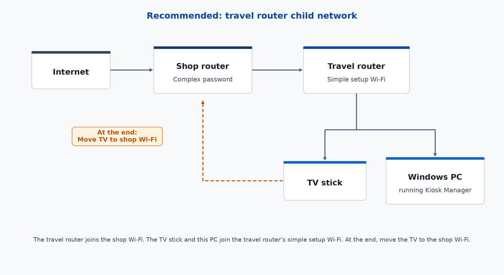

# Kiosk Manager

**Kiosk Manager** is a free Windows tool that turns an Android TV or Google TV device into a kiosk that only shows [Easy Display Player](https://play.google.com/store/apps/details?id=com.taknik.easydplayer). After setup, the TV opens Easy Display Player at start-up and whenever Home is pressed. Other apps stay installed — nothing is deleted — and you can undo everything later.

## Download

Get the latest Windows build here:

**https://github.com/BinaryExploits/kiosk-manager/releases/latest**

Download `KioskManager.exe` (or the zip that contains the exe and this README) and run it on your PC.

Windows SmartScreen will likely warn that the app is unrecognized, because the exe is not code-signed. Click **More info**, then **Run anyway**. If Windows Firewall asks about `adb`, allow it on private networks so the TV can be found automatically.

## What you need

- A PC running **Windows 10** or **Windows 11**
- An **Android TV** or **Google TV** device on **Android 11 or newer**, on the **same Wi-Fi** as the PC. This includes the Xiaomi Mi TV Stick 4K, Chromecast with Google TV, Google TV Streamer, and most Android TV boxes. The original Xiaomi Mi TV Stick (Android 9) is not supported.

## How to use it

The wizard has four steps: **Prepare → Connect → Easy Display Player → Make Easy Display Kiosk**.

### 1. Prepare the TV

Do this once on each TV with the remote. Keep the TV on, and keep this PC on the same Wi-Fi as the TV. If the shop Wi-Fi password is awkward to type on the remote, see [Wi-Fi setup tips](#wi-fi-setup-tips) (the wizard has the same page, from **Wi-Fi tips (complex password?)**).

On each TV, turn on Developer options and follow the path that matches the device.

### 2. Connect this PC to the TV

On the PC, run `KioskManager.exe`. On the Prepare step, pick the menu type that matches your TV, then go to Connect. The default connect method follows that choice.

Click **Find my TV** to scan this Wi‑Fi. The tool checks port **5555** on the PC’s local /24 subnet(s) and also uses Google TV / Chromecast discovery (`adb mdns`). Each result shows the IP, model, device name, and whether the kiosk is already installed. If a TV shows **Allow USB debugging?**, tick **Always allow from this computer** and press OK — the row will say **Waiting for Allow on TV** until you do. **Identify** shows a 4-digit code on that TV and in the wizard so you can tell similar TVs apart. If the kiosk app is not already installed, a temporary helper is installed only to show that code — the home screen is not changed — and is uninstalled when the code screen closes, you pick another TV, or you leave the scan. Select a row to fill the IP and connect, or tick several TVs and click **Set up selected TVs** to make each one a kiosk in one go (see below).

If the scan finds nothing, shop Wi-Fi often blocks device discovery — type the IP manually instead, or use a travel-router setup (see [Wi-Fi setup tips](#wi-fi-setup-tips)) so this PC and the TVs are on the same simple network.

**Xiaomi / Android TV: Connect by IP (USB debugging)**

1. Type the TV’s IP address (port **5555** is used if you do not add a port; `ip:port` is also accepted) and click **Connect**.
2. When the TV shows **Allow USB debugging?**, tick **Always allow from this computer** and press OK. The tool waits up to about a minute for that.

**Google TV / Chromecast: Pair with code (Wireless debugging)**

1. The tool tries to find the TV automatically. If it does not, type the IP address:port shown under the pairing code.
2. Enter the 6-digit pairing code and click **Pair**, then **Connect**. The connect port at the top of the Wireless debugging screen is different from the pairing port.

### 3. Easy Display Player

The tool checks whether Easy Display Player is installed. If it is missing, the Play Store page opens on the TV — press **Install** with the remote, and the tool continues by itself. Easy Display Player is the only app this tool can set as the kiosk.

### 4. Make Easy Display Kiosk

Click **Make Easy Display Kiosk**. The TV will then open Easy Display Player at start-up and whenever Home is pressed. If the TV asks which home app to use, choose **Easy Display Kiosk Manager** and **Always**. When it finishes, an **All done!** screen shows the TV’s name, IP and Android version, and reminds you how to open the Kiosk menu.

**Set up another TV** disconnects this device and returns to Prepare, so you can do the next TV in the same visit. **Turn off debugging** (on the All done screen) turns USB debugging off on that TV (`adb_enabled`, and Wireless debugging on Google TV) and disconnects this PC. Debugging is never turned off automatically. **Close** exits.

For a complex shop password or a travel-router setup, see [Wi-Fi setup tips](#wi-fi-setup-tips) (in the wizard: **Wi-Fi tips (complex password?)**).

**Move TV to shop Wi-Fi** is an optional button on the All done screen — it is never automatic. Enter the shop network name (SSID), the security type (WPA2, WPA3, or Open), and the password (masked, with a show-password toggle). You will be shown the name and password to check before anything is sent. On Android 11 or newer the tool saves the shop network on the TV (`cmd wifi add-network`) without removing the setup network, even if the shop Wi-Fi is out of range — the TV can join it later. The password is not saved on this PC and is not written to the log. If you are setting up several TVs, save the shop network on each one first and stay on the setup Wi-Fi until you have finished them all, then use **Set up another TV** — or use **Set up selected TVs** on the Connect step to do several in one go. If a TV does switch to the shop Wi-Fi straight away, this PC will lose that TV until you join the same shop Wi-Fi and use Find my TV — Kiosk Manager does not change this PC’s Wi-Fi for you. On Google TV / Chromecast, Wireless debugging usually turns off after a network change, so turn it back on (and pair again if asked) before you reconnect. If you also want to turn debugging off, press **Turn off debugging** only after this step, and only if you still want later access from this PC. If the TV is older than Android 11 or the command fails, the tool shows how to save the network in Settings (or from the hidden Kiosk menu: **TV Settings**). Leave the setup network saved if it is already there.

### Set up several TVs at once

On the Connect step, after **Find my TV**, tick the TVs you want and click **Set up selected TVs**. Kiosk Manager makes each selected TV an Easy Display Player kiosk, one after another. If a TV shows **Allow USB debugging?**, tick **Always allow from this computer** and press OK — that row will say **Waiting for Allow** until you do. Each row shows **Waiting**, **Installing**, **Done**, or **Failed** with a reason. A failure does not stop the others. **Retry failed** runs the same steps again only on the TVs that failed.

You can also tick **Save shop Wi-Fi on all selected TVs** (same network name and password for all; you will be shown those details to check first) and **Turn off debugging on all selected TVs**. Shop Wi-Fi is saved without removing the setup network. Debugging is never turned off unless you choose that option. The ordinary one-TV path (select a single row, then the wizard steps) is unchanged.

## Wi-Fi setup tips

If your shop Wi-Fi password is too long or awkward to type with the TV remote, use one of these options. This is for setting TVs up in the shop — including several TVs in one visit. In the wizard, this page is opened from **Wi-Fi tips (complex password?)** on Prepare and on Move TV to shop Wi-Fi.

**Recommended:** Add a child network with a second small router (a travel router) connected to your shop router, and give that child network a short, easy password. Join this PC and each TV to that simple setup Wi-Fi, then set up the kiosk on each TV. When a TV is ready, use **Move TV to shop Wi-Fi** (or **Set up selected TVs** for several at once) to save your shop network on it. The setup network stays saved too. The TV will join the shop Wi-Fi when that network is in range — often after you have finished the others. You do not need to type the shop password on the remote.

**Fallback:** Temporarily set a simple password on the shop Wi-Fi itself while you set up the TVs. When you change the password back, every device on that Wi-Fi is disconnected, and each one — including every TV — must rejoin with the original password.



The travel router joins the shop Wi-Fi. The TV stick and this PC join the travel router’s simple setup Wi-Fi. At the end, save the shop Wi-Fi on each TV (the setup network is left saved). Shop Wi-Fi sometimes blocks devices from finding each other, or shows a login page a TV cannot complete; a travel router avoids that, and Kiosk Manager can still find the TVs with Find my TV.

## Hidden Kiosk menu

The kiosk can look locked to Easy Display Player. To open a menu on the TV (no PC needed), hold **OK** (or the Centre / Enter key) for about 3 seconds, or press **Up Up Down Down Left Right Left Right**. This also works while Easy Display Player is in the foreground. You can also press **Home** twice quickly.

The menu can:

- **Restart Easy Display Player**
- **App settings / Clear data** (the TV’s app-info screen for Easy Display Player, where you can clear data or force stop)
- **TV Settings**
- **All apps**
- **Back to Easy Display Player**

A factory reset also removes the kiosk.

## Restore original

To put the original home screen back, run Kiosk Manager again, connect to the same TV, and click **Restore original** on the last step. That re-enables the stock launcher, turns off the kiosk menu shortcut, uninstalls the kiosk app, and leaves your other apps in place.

If you used **Turn off debugging**, first turn **USB debugging** back on in Developer options (and **Wireless debugging** on Google TV). Then connect with Kiosk Manager and click Restore original.

The wizard also has a **Reset options** page (a link on Prepare, Connect, and the All done screen) with every method below, including copyable adb commands.

## Reset options

These are the ways to undo the kiosk, clear Easy Display Player, or start the TV from scratch.

### 1. Factory reset (erases everything)

A factory reset deletes all apps, accounts, Wi‑Fi passwords and settings. You will have to set the device up again. Use this only if you cannot restore the kiosk any other way, or you want a completely clean device.

**Xiaomi Mi TV Stick 4K / Android TV — from Settings:** Settings › Device Preferences › Reset (some regions say Restart, Reset, or Recover; usually the last item under Device Preferences). Confirm the reset. From Xiaomi support: [Factory reset for TV, TV stick, Mi box](https://www.mi.com/global/support/article/KA-12918/) and the Mi TV FAQ (Settings › Device Preference › Reset).

**Xiaomi / Android TV — if the menus will not open:** Unplug the stick from power. Press and hold **Back** and **Confirm (OK)** on the Bluetooth remote at the same time, and plug the power back in while still holding both buttons. When recovery appears, choose **Wipe data / Factory reset** and confirm. From Xiaomi support: the same factory-reset article, and [What to do if the Mi TV Stick cannot enter the main screen?](https://www.mi.com/global/support/faq/details/KA-557214/).

**Google TV / Chromecast — from Settings:** Settings (profile or All settings) › System › About › Factory Reset, then confirm. From Google: [How to factory reset your Chromecast or Google TV Streamer](https://support.google.com/chromecast/answer/6254654).

**Google TV / Chromecast — if the menus will not open:** With the device plugged into the TV and powered on, press and hold the button on the **back** of the Chromecast or Google TV Streamer. The LED blinks yellow. When the light turns **solid white**, release the button — the device resets. From Google’s factory-reset article and [Fix an unresponsive Google TV device](https://support.google.com/googletv/answer/12360626). This cannot be undone and wipes the device.

### 2. Restore the normal launcher with Kiosk Manager

If this PC can still reach the TV, this is the safest option. Connect (debugging must be on) and click **Restore original** on the last step.

### 3. From the TV Kiosk menu

Hold **OK** for about 3 seconds (or Up Up Down Down Left Right Left Right, or Home twice quickly), even while Easy Display Player is open. Choose **TV Settings**, or **App settings / Clear data**.

### 4. Clear Easy Display Player data or uninstall it in Settings

If you can reach Settings: Settings › Apps (on Android TV often Settings › Device Preferences › Apps; on Google TV, Settings › Apps). Choose Easy Display Player, then Clear data / Clear cache, or Uninstall.

### 5. Manual ADB commands (without this tool)

Debugging must be on. If you used **Turn off debugging**, turn USB debugging back on in Developer options (and Wireless debugging on Google TV), then connect with adb.

Xiaomi Mi TV Stick 4K / Android TV:

```
adb shell pm enable com.google.android.tvlauncher
adb shell pm enable com.google.android.tungsten.setupwraith
adb uninstall com.easyd.kiosk
```

Google TV / Chromecast (also re-enable Google TV’s home screen):

```
adb shell pm enable com.google.android.tvlauncher
adb shell pm enable com.google.android.tungsten.setupwraith
adb shell pm enable com.google.android.apps.tv.launcherx
adb uninstall com.easyd.kiosk
```

## License

Kiosk Manager is released under the [MIT License](LICENSE) © BinaryExploits.

The Windows build bundles Google Android SDK Platform-Tools at build time (Google’s license terms).

## Building from source

For developers: JDK 17+, Android SDK (`build-tools;34.0.0`, `platforms;android-34`), .NET 8 SDK, Python 3, and curl. Builds on Linux, macOS, or Windows (bash); the exe is cross-published for win-x64.

The APK must be signed. **No keystore is in this repo.** To update an already-installed `com.easyd.kiosk`, you need the same signing key; otherwise run Restore first.

```bash
export ANDROID_SDK_ROOT=/path/to/android-sdk
export JAVA_HOME=/path/to/jdk
export KIOSK_KEYSTORE=/secure/path/kiosk.keystore
export KIOSK_KEYSTORE_PASS='...'          # never commit this
# first time only, to create a new key:  export KIOSK_GENERATE_KEY=1

./apk/build.sh                    # -> apk/build/EasyDKiosk.apk
./win/fetch-payload.sh            # copies the APK + downloads Google platform-tools into win/payload/
cd win && dotnet publish -c Release -o out   # -> win/out/KioskManager.exe (~80 MB, self-contained)
```

`win/payload/` is git-ignored. If platform-tools is not embedded, the exe downloads it from Google on first run.

Confirmed on a Xiaomi Mi TV Stick 4K (Android 11) with Easy Display Player, including Connect by IP and Make Easy Display Kiosk. The Google TV pairing path was also used on a Chromecast with Google TV. The Windows UI was built on Linux.
